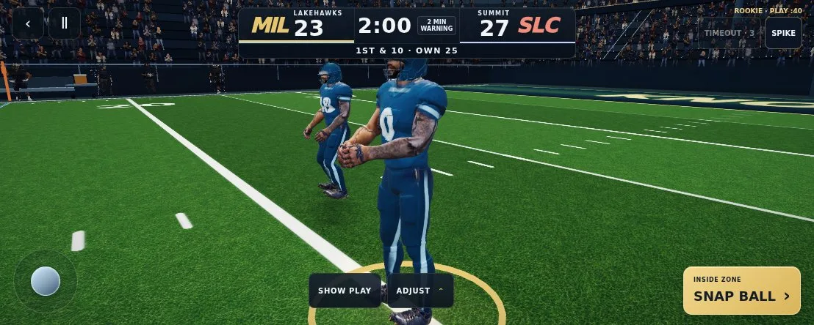
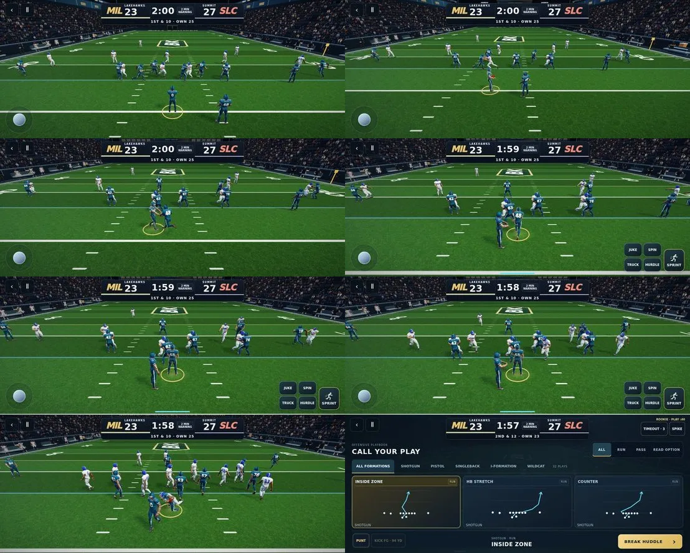
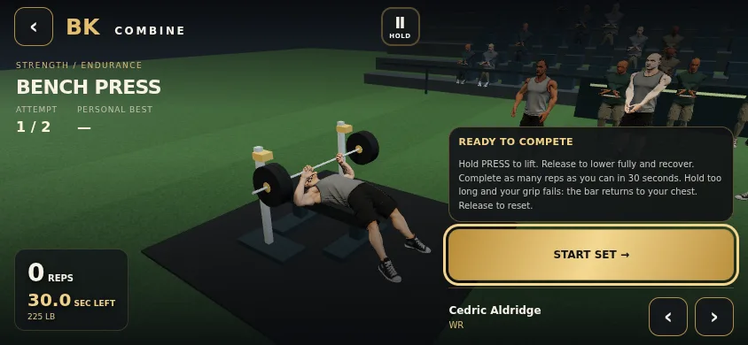
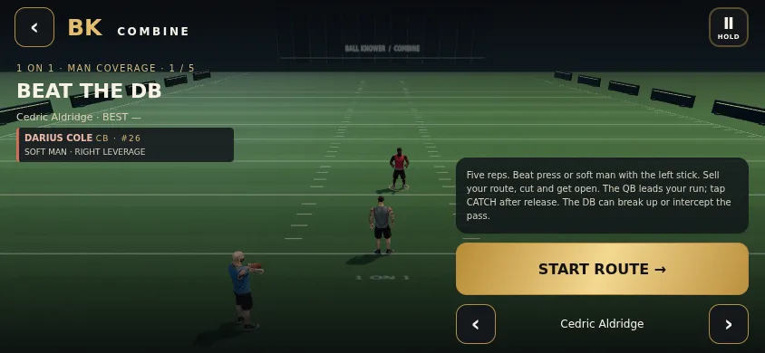
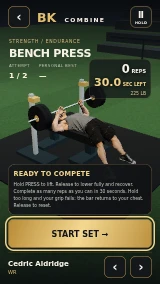

# Field and athlete visual upgrade

Existing athlete meshes, skeletons and approved running clips are preserved. This is a material, lighting and presentation upgrade, not replacement character models.

- Full-game helmets use a painted clearcoat response; cloth uses matte, derivative-filtered knit, collar detail and restrained edge light. Team colors, jersey numbers and helmet geometry remain intact.
- More legible five-yard mowing bands exclude field paint using the existing grass mask.
- Bounded upper-body breathing, scanning and nodding while stationary before/between plays. Disabled during gameplay, engagement and falls; roots, ball handling and feet are unaffected.
- Combine lighting separates skin and compression fabric; turf bump is reduced. Padded perimeter rails, roof strips and wall panels use two static instanced batches outside playable lanes, with no additional shadow pass.
- Public entry/module versions advance together to refresh cached assets.

## Verification

Passed: `npm run lint`, `npm run build`, `npm run check:gameplay-3d`, `node scripts/check-field-visuals.mjs`, `node scripts/check-reference-equipment.mjs`, `node scripts/check-reference-contact.mjs`, and `node scripts/check-presentation-clock.mjs`.

Equipment check uses the actual `reference-helmeted-athlete-v1.glb`: unchanged body/skeleton/all 11 clips, rigid head equipment, both routes, zero WebGL/page errors. Clock check exercises slowed catches at 120 Hz in both game modes with no pose-time rewind. Contact checks cover landing, grip, ball clearance and block contacts.

Normal controls in `scripts/play-game-review.mjs` exercised inside-zone snap, exchange, run, contact, landing and next play in both modes. Deterministic recordings reviewed visually; real requestAnimationFrame also exercised in five-minute mode through contact and back to the playbook, with zero WebGL/page errors. Reports: [play-report.json](play-report.json).

Combine bench controls passed guarded pause, slow frame/blur, overhold return and release rearm assertions. Bench and shuttle layouts captured at 320×568, 390×680 and 844×390; bench controls/bounds passed. Bench and one-on-one scenes visually reviewed after native athlete loading.

## Visual evidence

## Limits

Chromium 153 with SwiftShader software rendering. Real-time captures were heavily GPU-limited (30 rendered frames over roughly 35 wall seconds in one recording); these are functional/visual checks, not physical iPhone FPS certification. Deterministic recordings provide the frame-by-frame motion review. No new mesh assets, texture downloads or shadow passes were added. Existing Vite chunk-size warnings remain. Physical iPhone/Chromebook performance remains a device check.
