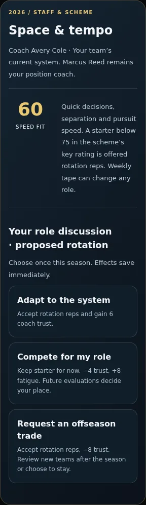
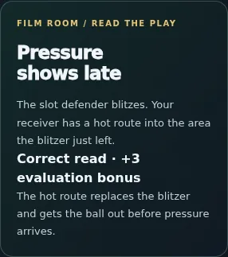
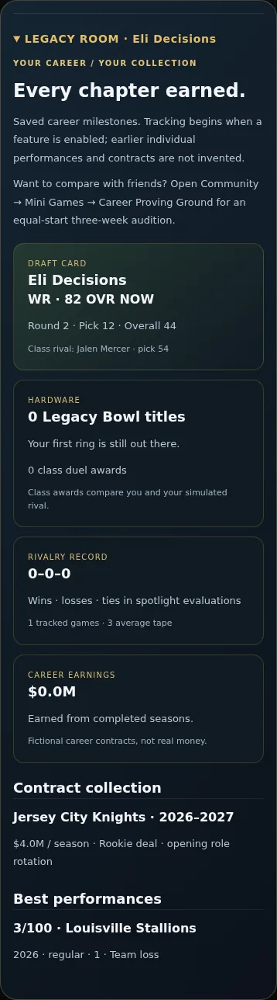
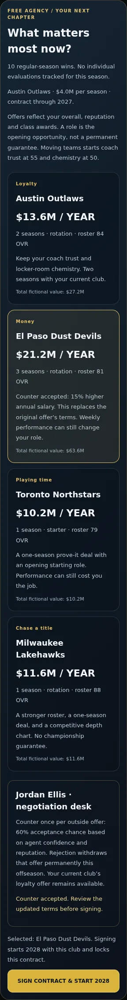
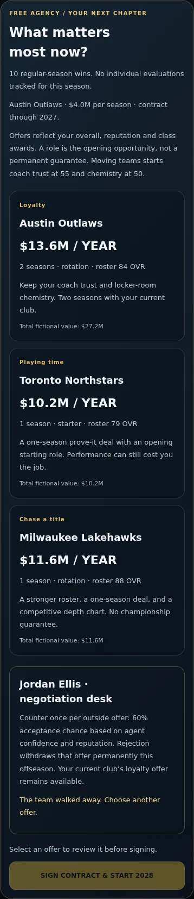
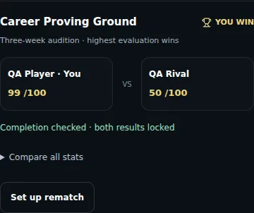

# My Player decisions, legacy and Community career challenges

## User story

My Player decisions persist into role, performance and offseason transitions. Community → Mini Games → Career Proving Ground gives two players identical rookie/seed conditions, then compares completed three-week sessions through the existing private challenge RPC.

## Changes

- Team staff/scheme rotates every two seasons. Speed, power or awareness determines scheme fit. Starters below 75 fit receive a rotation proposal. Adapt gains trust; compete holds the opening role with trust/fatigue costs; request a trade unlocks offseason destinations or withdrawal. A trade retains the existing salary and remaining term, resets new-team relationships, and preserves career progress.
- Optional position-aware film reads before weekly assignments: one answer, explanatory feedback, +3 on the final evaluation for a correct answer (100 cap). Replay/duplicate completion cannot stack it.
- One counter per outside free-agent offer: 15% more annual money or starting role. Acceptance depends on agent confidence/reputation with a stable seeded outcome. Rejection withdraws the offer; the non-negotiable loyalty fallback remains available. Decisions and updated terms survive reload; signing is a separate explicit action.
- Legacy Room: draft card, recorded titles and class awards, spotlight record, earnings, contract collection and top five tracked performances. Older saves initialize without reconstructing missing individual tape or contracts.
- Career Proving Ground: three weeks of preparation, film and five tactical receiving reps per week; both entrants start at 20 fatigue with the same seed and no Solo upgrades. Resume completed weeks on the same device. Local storage failures keep current progress in memory and provide retry; network failures provide an idempotent submit retry.
- Server validates all nine transcript fields, completion, integer/range constraints, participant/attempt token and existing access/expiry restrictions. It computes the final average itself and locks the first result. Only completed, server-checked career comparisons show “Completion checked · both results locked.” Gameplay timing remains device-reported; this is not anti-cheat certification. No trivia rating or Solo save changes.
- Living-career upgrade/restart controls now sit in document flow with practical phone targets; they no longer cover coach or film decisions. Career challenge UI is lazy-loaded.

## Verification evidence

| Boundary | Evidence |
| --- | --- |
| Models and persistence | `my-player-decisions-check.ts`: all scheme choices, staff rotation, once-only film bonus, invalid input, legacy saves, permanent best tape, trade/stay, term and salary continuity, counter acceptance/withdrawal/fallback |
| Solo UI → save → next season | `my-player-decisions-browser.mjs`: actual UI at 320/390/1280, normal-control tactical moment, +3 film bonus, real weekly game resolution, Legacy Room, trade, accepted/rejected counter, reload, signing into 2028 |
| Community UI → transcript → response | Same browser script: 15 actual normal-control reps, preparation/film, week-one exit/resume, simulated quota failure and retry, network failure and retry, returned score, locked comparison and reload. Browser RPC adapter is a fixture; server is tested independently below. |
| RPC → private data → comparison | `mini-challenges-integration.sql` executed inside a rollback transaction with the candidate migration. All 11 game types, winner and tie rules, guest/outsider rejection, friendship, attempt tokens, immutable retries, full transcript, forged score rejection, integer/range limits, expiry, blocks and direct-table isolation. Server career score 85 matches JS arithmetic. No real user data retained. |
| Existing career compatibility | `my-player-arc-browser.mjs`: 320/390/1280 renewal/loyalty/transfers, storage error, spotlight, preserved roster/XP; old offseason draft completes seven real selections and retains rookies after migration/reload |
| Existing Community games | `mini-challenges-browser.mjs`: 320/390/1280, guest gate, friend challenge, real 3D dash → iframe bridge → retry → locked comparison; spoofed parent message rejected |
| Shared regressions | Typecheck/build; arc/career/field/mini-challenge models; Solo fictional universe, franchise interactions, integrity and Community arena/state checks |

Security review: private tables remain RLS-enabled with no direct client grants; public wrapper remains SECURITY INVOKER; existing private SECURITY DEFINER retains empty search path and permanent-user/ownership checks. No new exposure or credentials. Existing unrelated project advisor findings are not changed by this release.

## Visual review

Phone screenshots were inspected; the initially overlapping floating upgrade panel was corrected and the 320/390/1280 flows rerun.

## Limits

Synthetic season-completion fixtures exercise offseason boundaries without claiming that dozens of full team games were manually played. Community browser transport is mocked, while real Postgres transactions cover authorization, scoring and storage separately. No full-game animation changes and no physical iPhone FPS claim. Career fields and salaries are fictional. Existing saves gain tracking from activation, not fabricated backfill.
