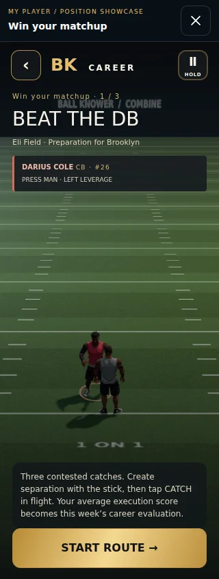
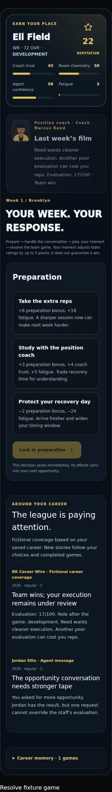

# My Player: 3D assignments and reactive career coverage

Weekly career preparation now offers three-rep 3D receiver, running-back and coverage showcases. WR/TE play contested catches, RB controls cuts and contact moves, CB/S/LB control coverage. QB can play the existing two-minute team-control showcase (Jersey City vs Brooklyn); EDGE retains the explicitly labeled tactical pass-rush assignment. All positions retain tactical play as a lighter alternative. These are career evaluations, not replacements for the scheduled full-team simulation.

The first completed 3D or tactical result locks into the existing career turn. Existing preparation/fatigue adjustment, simulation influence, role evaluation and persistence apply unchanged. Three-rep career sessions use a stable per-career/week seed and do not write Combine bests or report Community results. The QB frame reuses the result transport, with origin, source, session and token checks plus score validation; its 23 starting points are excluded from earned points. An unfinished exit posts nothing.

The career feed derives articles from saved choices and the last 12 game evaluations. It distinguishes strong individual tape in a loss from poor tape in a win, reports observed role transitions, and follows up agent requests. Stories are stable across reloads and clearly labeled fictional career coverage. No save migration or network service is required.

## Validation

- TypeScript and production Vite build.
- `scripts/my-player-field-check.ts`: invalid/partial results, initial-points exclusion, stable seeds, first-result locks, simulation influence, promotion and win/loss news, reload stability.
- `scripts/my-player-field-browser.mjs`: normal-control complete WR/RB/CB 3D sessions at 320/390/1280 widths; LB/TE/S launches; incomplete exits; score persistence; no Combine leaderboard writes; news reload; QB frame launch and wrong-source rejection. A separate transport test sends a valid and duplicate QB message from its frame; this is not presented as a played full-game result.
- Career compatibility browser: earned-role opt-in, portrait bounds, Selection Sunday, gated playoff and actual playoff simulation, once-only callback, keyboard tactical play.
- Existing career, journey, draft Combine, Solo fictional-universe, franchise-interactions, integrity and Community checks.
- Existing receiver, man-coverage, RB and DB gameplay regressions across multiple frame rates; presentation-clock regression for both full-game modes.
- `play-game-review.mjs`: existing two-minute normal-control snap, handoff, run, tackle and next-play transition reviewed from a 17-frame sequence; real requestAnimationFrame sequence also captured, with no JavaScript or GL errors. No full-game physics or animation code changed.

## Limits

The 3D position showcases reuse the established Combine practice field and opposing athletes. QB uses team control and fixed showcase teams, not a new personal QB-only renderer. EDGE does not have a dedicated 3D pass-rush mode. Full scheduled games remain simulated. Software graphics QA does not establish physical iPhone FPS. Career saves retain the existing device-local storage behavior.

## Screens

