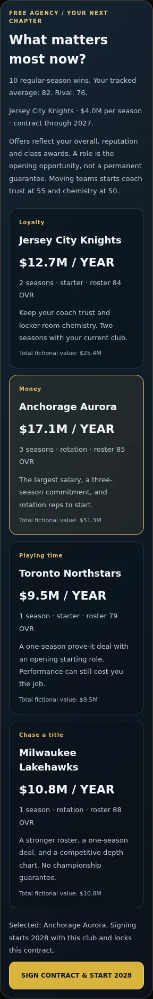
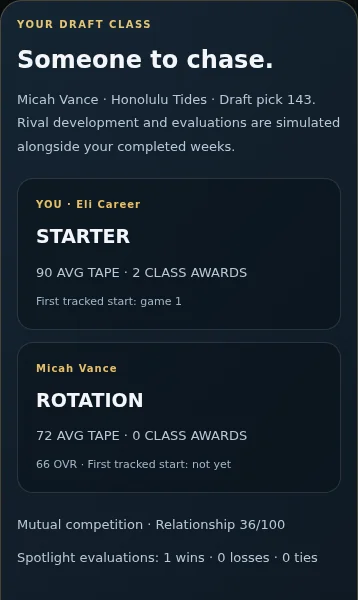

# Draft-class rivalries, career timelines, contracts and free agency

My Player living careers now track one persistent draft-class rival. When the saved draft story exists, the rival comes from that frozen draft board, with matching name, team and draft pick. Older careers get a deterministic fictional class rival; unrecorded earlier performances are not invented. Dante remains the separate training-camp/depth-chart rival.

Weekly optional choices train together, maintain respect, or talk trash. Effects save once and cannot be applied retroactively after a completed performance. Rival evaluations and development are explicitly simulated. Spotlight assignments activate only against the rival's actual scheduled team, compare the two evaluations and award bounded reputation changes separately from the team result. First tracked starting roles, decisions, comparisons, class-duel awards and contracts enter the timeline. Draft origin and first starts are retained when routine events roll off.

The fictional rookie contract lasts two seasons. At contract expiry, four reviewable offers trade salary and duration against opening playing time, roster strength and loyalty. Signing changes the actual next-season team, roster, opening role, salary and relationship baseline. Staying retains the club, coach trust and chemistry. Career earnings accrue at completed season boundaries. Class awards compare the two tracked prospects and are not mislabeled as league-wide awards. Full games remain simulated and existing 3D/tactical evaluations remain available.

A selected deal is saved before the next season mounts. A failed write leaves the current season intact. Year/team checks prevent an old season from being restored under a new contract. An older save already in an offseason draft can finish its selections, retain its rookies and advance its career year. Living-career rookie reconciliation preserves the legal roster size. Career seasons cannot be rewound via the generic season reset; New Player remains the explicit full restart. Other franchise modes retain their draft and restart flows.

## Verification

- TypeScript and production build.
- `my-player-arc-check.ts`: five seasons / 85 weeks, frozen draft-board identity, seeded rival progression, choice locks, pressure penalty, spotlight results, first starts, timeline preservation, awards, contract expiry, four offer tradeoffs, salary/earnings, transfers and renewals, malformed saves, replay prevention.
- `my-player-arc-browser.mjs`: actual MyPlayerStory at 320/390/1280. Under-contract offseason, offer review, money/playing-time/loyalty signing, correct team/year/role/salary, retained XP and history, reload, relationship choice, actual scheduled spotlight simulation. Storage failure keeps the old season. Existing draft performs seven real UI selections, retains rookie membership and legal roster size, and survives reload. Season-end fixtures and completed moment scores are seeded to isolate these transitions; this does not claim 85 manually played browser games.
- Career compatibility browser: existing earned role and roster IDs on opt-in, portrait bounds, Selection Sunday, actual playoff game, once-only progression, keyboard tactical controls.
- Existing career, journey, Solo fictional universe, franchise interactions, integrity, Community and field/news regressions.
- Inspected phone offer and rivalry screens. No full-game animation or control code changed. No physical-device FPS claim.

## Screens

